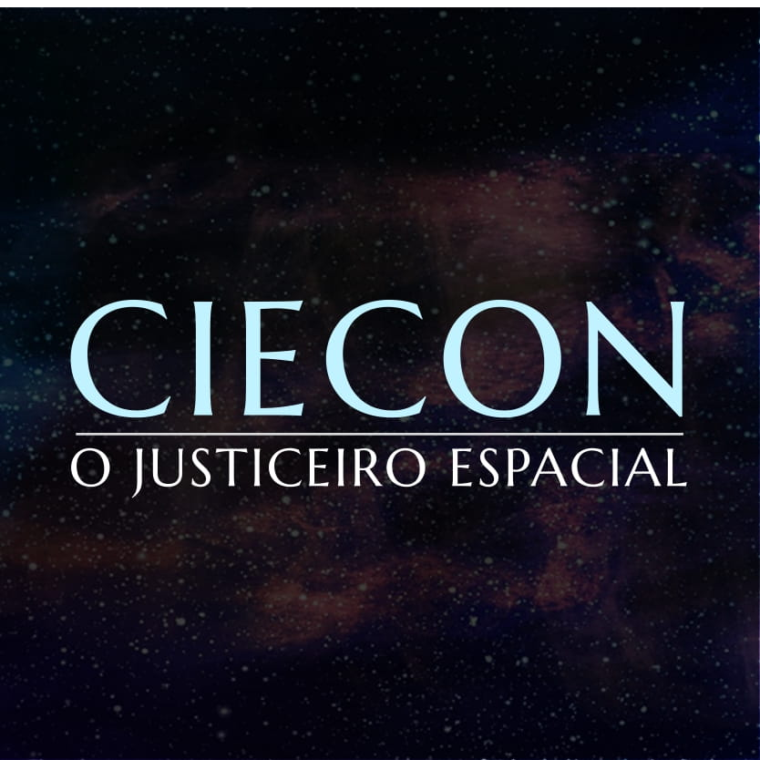

# Ciecon

> **Universo UVC** • Escala: **UNIVERSAL** • Alinhamento: **Herói / Líder Cósmico**

## 📋 Informações Gerais
- **Nome Real / Identidade:** Ciecon
- **Afiliação / Equipe:** Congregadores
- **Alinhamento:** Herói / Líder Cósmico
- **Ambiente de Atuação:** UNIVERSAL

## 📖 Biografia & Origem
Líder dos Congregadores e justiceiro intergaláctico. Um jovem comum que, ao equipar o lendário Bracelete Divino, derrotou o Demônio. Consciente da imensidão de sua responsabilidade, cruza galáxias para libertar mundos escravizados.

## ⚡ Habilidades & Poderes
- **Conjuração de portais de dobra espacial para transporte de matéria**
- **Subconsciente racional e falante (Guia tático cósmico)**
- **Disparos de energia pelo Bracelete**

## 📚 Aparições no Cânone
- Ciecon (Solo)
- Congregadores (Série)

---
*Documento canônico do Universo Virtual de Caio (UVC).*
