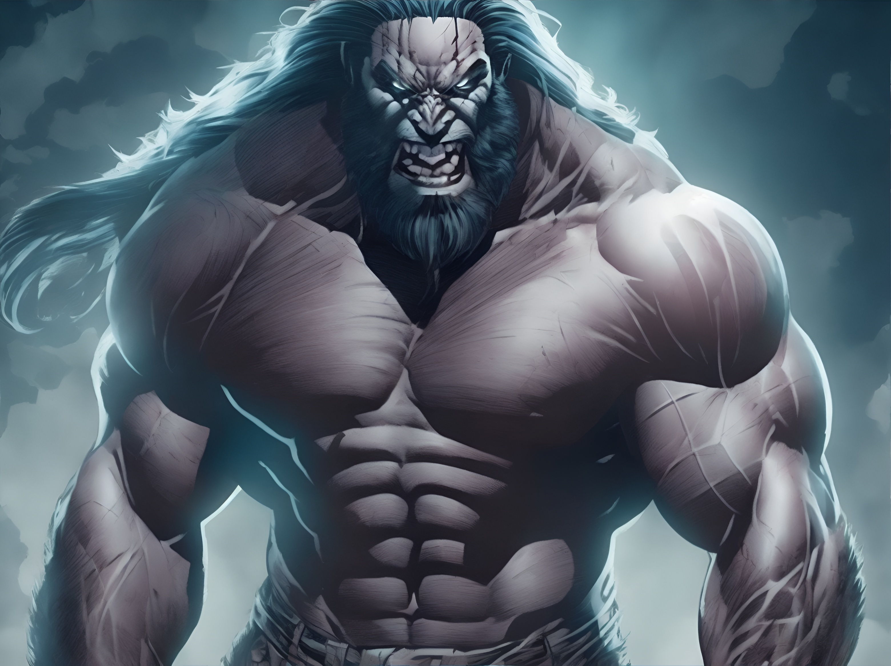

# Delimitador

> **Universo UVC** • Escala: **UNIVERSAL** • Alinhamento: **Brutamontes / General Bélico**

## 📋 Informações Gerais
- **Nome Real / Identidade:** Delimitador
- **Afiliação / Equipe:** Red Right Hand
- **Alinhamento:** Brutamontes / General Bélico
- **Ambiente de Atuação:** UNIVERSAL

## 📖 Biografia & Origem
Um colosso geneticamente reconstruído com mais de 3 metros de altura e cerca de 600 kg. Ex-guerreiro consumido pela ira, agora atua como o principal ponta-de-lança da RRH.

## ⚡ Habilidades & Poderes
- **Força física astronômica**
- **Resistência a bombardeios e calor extremo**
- **Massa muscular hiper-densa**

## 📚 Aparições no Cânone
- Red Right Hand (Série)
- Punho Mortal

---
*Documento canônico do Universo Virtual de Caio (UVC).*
