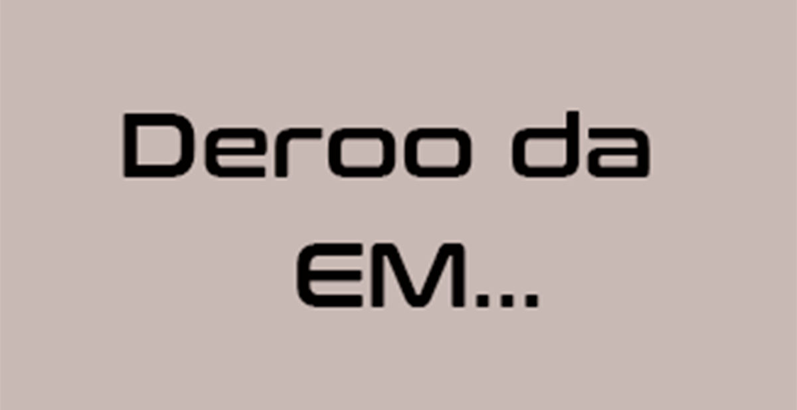

# Deroo Da

> **Universo UVC** • Escala: **UNIVERSAL** • Alinhamento: **Cientista Neutro**

## 📋 Informações Gerais
- **Nome Real / Identidade:** Deroo Da
- **Afiliação / Equipe:** Red Right Hand
- **Alinhamento:** Cientista Neutro
- **Ambiente de Atuação:** UNIVERSAL

## 📖 Biografia & Origem
Gênio científico da Red Right Hand. Mestre em cibernética, mecatrônica espacial e sistemas autônomos. Guarda segredos e planos tecnológicos que nem mesmo Arner é capaz de antecipar.

## ⚡ Habilidades & Poderes
- **Intelecto de nível superior em engenharia cibernética e veículos de dobra**
- **Criação de armaduras, drones e implantes bio-mecânicos**
- **Vasto domínio em ciências humanas e computação**

## 📚 Aparições no Cânone
- Red Right Hand (Série)
- Deroo Da no Espaço (Série)
- Congregadores

---
*Documento canônico do Universo Virtual de Caio (UVC).*
