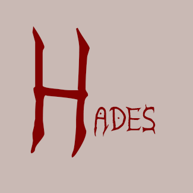

# Hades (O Demônio / Soberano do Mal)

> **Universo UVC** • Escala: **UNIVERSAL / TERRA** • Alinhamento: **Vilão Supremo**

## 📋 Informações Gerais
- **Nome Real / Identidade:** Hades (O Demônio / Soberano do Mal)
- **Afiliação / Equipe:** Aliança Demoníaca / Universal
- **Alinhamento:** Vilão Supremo
- **Ambiente de Atuação:** UNIVERSAL / TERRA

## 📖 Biografia & Origem
A antítese cósmica de Ormuz. Entidade divina do mal que assumiu encarnações físicas para dominar planeta por planeta. Tentou subjugar a Terra através da Aliança Demoníaca e trama incansavelmente tomar posse de toda a criação.

## ⚡ Habilidades & Poderes
- **Poder destrutivo inestimável**
- **Absorção de energias vitais e poderes alheios (O Lampião)**
- **Teletransporte dimensional**
- **Manipulação mental e telecinese global**

## 📚 Aparições no Cânone
- Hades (Solo)
- Guardiões (Série)
- Ciecon (Solo)

---
*Documento canônico do Universo Virtual de Caio (UVC).*
