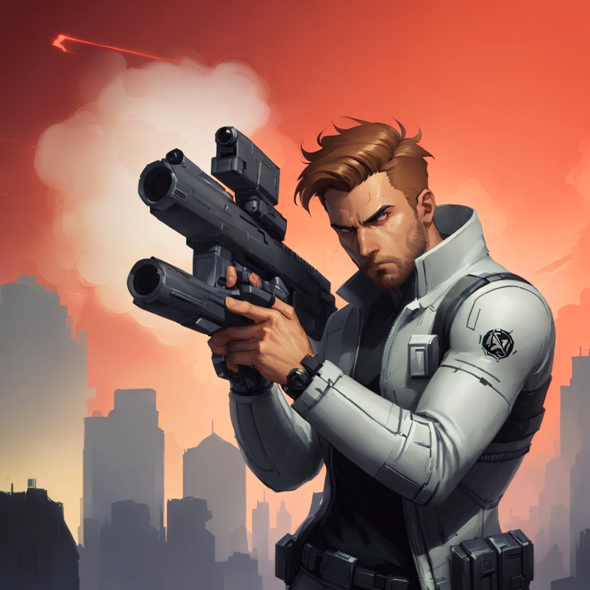

# Tarlin

> **Universo UVC** • Escala: **UNIVERSAL** • Alinhamento: **Comandante Militar**

## 📋 Informações Gerais
- **Nome Real / Identidade:** Tarlin
- **Afiliação / Equipe:** RRH / Fingers
- **Alinhamento:** Comandante Militar
- **Ambiente de Atuação:** UNIVERSAL

## 📖 Biografia & Origem
Líder do esquadrão de elite Fingers. Exímio atirador de elite com mira infalível e portador do rifle lendário Katharízo. Severo com seus soldados, mas protetor de sua equipe.

## ⚡ Habilidades & Poderes
- **Dilação temporal (habilidade de desacelerar o fluxo do tempo)**
- **Porte do rifle sniper lendário Katharízo**
- **Percepção sensorial ampliada**

## 📚 Aparições no Cânone
- Red Right Hand (Série)

---
*Documento canônico do Universo Virtual de Caio (UVC).*
