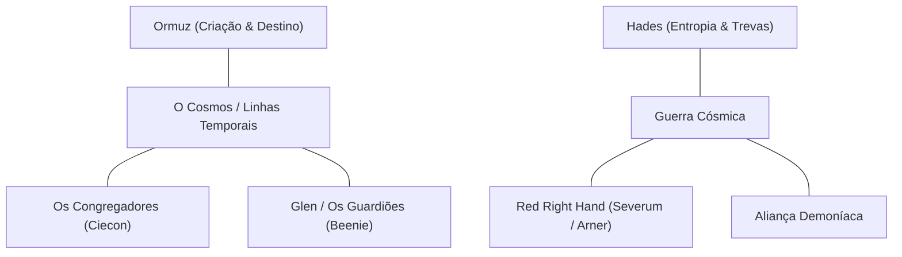

# Cosmologia do Universo UVC

O Universo UVC é governado por uma dualidade metafísica fundamental entre criação, ordem e caos destrutivo, dividindo-se entre a esfera cósmica intergaláctica e a esfera planetária humana (Terra).

## 🌌 As Entidades Primordiais

### Ormuz: A Mente da Criação
Ormuz é a força divina primordial que teceu as casualidades e leis físicas do universo. Raramente intervém de forma física direta, mas suas bênçãos e artefatos (como o *Bracelete Divino*) escolhem campeões capazes de restaurar a harmonia quando a tirania ameaça o tecido da realidade.

### Hades: O Soberano da Ruína
Antítese de Ormuz, Hades representa a consumação do mal e da entropia universal. Insatisfeito em governar apenas o plano espiritual sombrio, encarnou em forma física para subjugar mundos, extrair suas energias através do temido artefato *O Lampião* e marchar até destronar o criador supremo.

## 🪐 As Duas Escalas de Narrativa

1. **A Escala Planetária (Terra / Glen):**
   - Focada no drama humano, amadurecimento, superação de traumas e heroísmo urbano.
   - Protagonizada por **Beenie** (Os Guardiões), **Larry** (Menino Resiliente) e o vingador sombrio **Kerry**.
   - Conflitos contra máfias e gangues locais (como os Tineros) e as infiltrações da Aliança Demoníaca.

2. **A Escala Intergaláctica (Universal / Severum / Espaço Profundo):**
   - Focada em geopolítica estelar, guerras coloniais, mercantilismo bélico e ficção científica cósmica.
   - Protagonizada pela cruzada libertadora dos **Congregadores** (liderados por Ciecon), o expansionismo corporativo-militar de **Severum** (sob a Red Right Hand de Arner) e o avanço galáctico de Hades.
